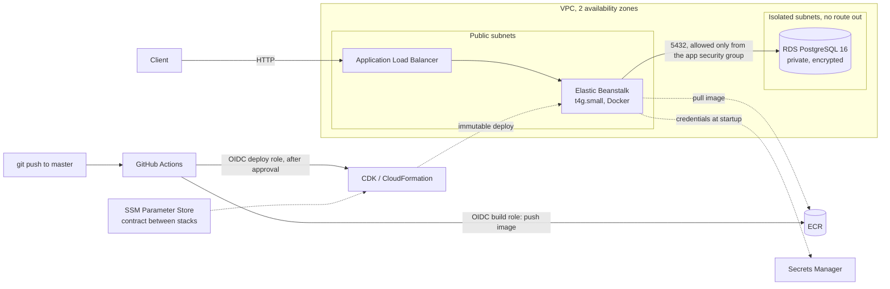

# TradeDesk — Trade Journal & Risk Analytics API

[](https://github.com/emiliogonz/tradedesk/actions/workflows/ci.yml)

A Spring Boot backend for booking FX trades, tracking positions and risk
limits, and reporting P&L, modeled on the kind of system used in trading
operations. It runs on AWS, defined entirely as code, and ships through a
CI/CD pipeline with no stored cloud credentials.

Built as a portfolio project focused on backend engineering fundamentals:
concurrency-safe domain logic, secure stateless auth with role-based access,
explicit schema management, real-database integration tests, and
production-grade deployment.

## Stack

**Application**
- **Java 25**, **Spring Boot 4.1.1**
- **Spring Security** with stateless JWT auth (jjwt 0.12) and method-level
  role checks
- **Spring Data JPA / Hibernate** on **PostgreSQL 16**
- **Flyway** for versioned schema migrations
- **JUnit 5 + Testcontainers** for integration tests against a real Postgres

**Infrastructure and delivery**
- **Docker**: multi-stage, layered, non-root image
- **AWS CDK (Java)** for infrastructure as code
- **AWS**: Elastic Beanstalk (Graviton), RDS PostgreSQL, Secrets Manager, ECR,
  SSM Parameter Store, CloudWatch Logs
- **GitHub Actions** with OIDC federation to AWS and approval-gated deploys

## Architecture

### Request flow

```
Client (curl / Postman)
        │  REST/JSON + Bearer JWT
        ▼
JwtAuthFilter ──► SecurityContext ──► @PreAuthorize role checks
        │
        ▼
Controller → Service (@Transactional) → Repository (Spring Data JPA / Hibernate)
        │
        ▼
PostgreSQL (schema owned by Flyway)
```

### Deployment on AWS



The infrastructure is split into three CDK stacks:

| Stack | Contents | Lifetime |
|---|---|---|
| `TradedeskData` | VPC, RDS Postgres, Secrets Manager secrets, ECR repository, SSM parameters | Long-lived; holds all state |
| `TradedeskApp` | Elastic Beanstalk application and environment, instance and service roles | Disposable; destroyed between sessions to save cost |
| `TradedeskCi` | GitHub OIDC provider, build role, deploy role | Long-lived; free |

Domain entities: `User`, `Instrument`, `Trade`, `Position`, `RiskLimit`,
`MarketRate`, `PnlSnapshot`.

## Roles

| Role | Can | Granted by |
|---|---|---|
| `TRADER` | Book trades, view positions and P&L | Default at registration |
| `RISK` | Set risk limits and end-of-day marks | An `ADMIN` |
| `ADMIN` | Change user roles | An `ADMIN` (the first one via a one-time bootstrap) |

Duties are deliberately separated: an `ADMIN` cannot set risk limits, so no
single account can both grant itself power and use it.

## API

All endpoints except register, login, and health require
`Authorization: Bearer <token>`.

| Method | Path | Access | Description |
|---|---|---|---|
| POST | `/api/auth/register` | Public | Create a user account (role `TRADER`) |
| POST | `/api/auth/login` | Public | Exchange credentials for a JWT (15-minute expiry) |
| GET | `/api/auth/me` | Any user | Return the currently authenticated user |
| GET | `/actuator/health` | Public | Health check used by the load balancer |
| POST | `/api/instruments` | Any user | Create an instrument |
| GET | `/api/instruments` | Any user | List instruments |
| POST | `/api/trades` | Any user | Book a trade; rejected if it would breach the instrument's risk limit |
| GET | `/api/trades` | Any user | Search trades: filters `instrumentId`, `from`, `to` (ISO dates); paginated via `page`, `size`, `sort` |
| GET | `/api/positions` | Any user | Positions with limit, average rate, mark, and realized/unrealized P&L |
| GET | `/api/pnl?from=&to=` | Any user | Daily P&L snapshots per instrument, in quote currency |
| PUT | `/api/risk-limits/{instrumentId}` | `RISK` | Create or replace an instrument's limit |
| PUT | `/api/marks/{instrumentId}` | `RISK` | Set an instrument's end-of-day mark |
| PUT | `/api/admin/users/{userId}/role` | `ADMIN` | Change a user's role |

## Design decisions

### Domain and data

- **Flyway owns the schema.** Hibernate runs with `ddl-auto: validate`, so it
  checks the entity mappings against the schema but never alters it. Every
  schema change is an explicit, versioned, reviewable migration.
- **Positions are maintained on write under a row lock.** Each trade updates
  its instrument's position in the same transaction, after locking the
  position row with `SELECT ... FOR UPDATE`. A concurrency test fires 20
  simultaneous trades at one instrument and asserts no updates are lost;
  without the lock, the same test ends with 3,000 of exposure instead of
  20,000.
- **Risk limits fail closed and are checked under the position lock.** An
  instrument with no configured limit cannot be traded. The check reads the
  exposure while the position row is locked, so concurrent trades cannot
  jointly breach a limit: five simultaneous 300k trades against a 1M limit
  always produce exactly three fills and two rejections. Trades that reduce
  absolute exposure are always allowed, even when the desk is over its limit.
- **N+1 avoidance.** The trade search uses `JOIN FETCH` on the instrument, and
  the positions view is a single DTO projection query joining positions,
  instruments, marks, and limits. `LEFT JOIN`s keep positions that have no
  mark or limit yet instead of silently dropping them.
- **Open Session In View is disabled.** Database access happens only inside
  service transactions, so lazy loading can't leak into the web layer and hide
  extra queries.

### P&L

- **P&L uses weighted-average cost, maintained on write.** Each position
  stores its average entry rate and cumulative realized P&L, updated in the
  same transaction and under the same row lock as the trade itself, so
  concurrent trades can't corrupt either. Adding to a position blends the
  average; reducing realizes P&L on the closed quantity and leaves the average
  unchanged; trading through zero realizes the closed part and opens the
  remainder at the trade's rate.
- **The P&L rules live in one pure class.** `PnlCalculator` has no Spring or
  database dependencies, so every case (opening, blending, partial and full
  close, flipping, shorts) is covered by unit tests that run in milliseconds.
  Integration tests only verify that the results are persisted.
- **Money math uses banker's rounding.** All P&L and average-rate calculations
  use `BigDecimal` with `RoundingMode.HALF_EVEN`, avoiding the upward bias that
  always rounding .5 up introduces over many operations.
- **P&L is reported in each instrument's quote currency and never summed
  across currencies.** EUR/USD P&L is in USD, USD/JPY in JPY. Every position
  and snapshot carries its currency, so no client can add a JPY figure to a USD
  one.
- **Unknown is not zero.** Unrealized P&L is `null` when an instrument has no
  mark, and `0` only when the position is flat. Reporting `0` for an unmarked
  position would falsely claim it is breaking even.
- **Marks are set by RISK and attributed.** End-of-day rates are posted
  through a RISK-only endpoint, and each mark stores who set it and when,
  because a mark directly changes reported P&L.
- **Daily snapshots follow FX conventions and are idempotent.** A scheduled
  job records each active position at 5pm New York time (the FX end-of-day
  convention), using the same time zone for the trigger and the snapshot date.
  Snapshots store cumulative realized P&L, so a day's P&L is the difference
  between consecutive snapshots and a missed day doesn't corrupt later ones.
  Re-running the job for a date replaces that date's rows rather than
  duplicating or failing.

### Security

- **Stateless JWT auth.** No server-side sessions; each request is
  authenticated from its token. CSRF protection is disabled because there are
  no cookie-based sessions to protect.
- **Authorization is enforced on the service layer.** `@PreAuthorize` sits on
  service methods rather than controllers, so the rules hold no matter what
  calls the operation.
- **The last admin can't be demoted.** Demotions lock the admin rows (in a
  consistent order, to avoid deadlocks), so two admins demoting each other at
  the same moment can't leave the system with no admin.
- **No fallback for the JWT secret.** `jwt.secret` is read only from the
  `JWT_SECRET` environment variable, with no default in `application.yml`.
  The app fails fast at startup if it's missing, rather than running with a
  secret committed to a public repo.
- **Invalid tokens are logged at debug level.** Expired or malformed tokens
  are routine, so they're silent by default but can be surfaced with
  `logging.level.com.example.tradedesk.security: debug` without a redeploy.

### Infrastructure and delivery

- **Infrastructure as code with AWS CDK (Java).** Every AWS resource is
  defined in `infra/`. Infrastructure has its own unit tests, which assert
  security properties such as the database being private and encrypted,
  secrets never appearing as plain environment variables, and OIDC roles
  trusting only the expected GitHub identities.
- **The database is unreachable from the internet.** RDS sits in isolated
  subnets with no route out, and its security group accepts Postgres traffic
  only from the app's security group. Credentials are generated by AWS and
  injected from Secrets Manager at instance startup; they never appear in
  templates, and in normal operation no human handles them. The one exception
  is break-glass database access for the first-admin bootstrap, which is
  IAM-authorized and audited in CloudTrail.
- **No NAT gateway.** App instances sit in public subnets, locked down by
  security groups so they only accept traffic from the load balancer. This
  avoids the hourly cost of a NAT gateway while the database stays fully
  isolated.
- **Stacks are decoupled through SSM Parameter Store.** The data stack
  publishes the values the app needs as named parameters, and the app stack
  reads them at deploy time. Either stack can be deployed alone, and the app
  can be torn down and recreated without touching the database.
- **CI/CD without stored cloud credentials.** GitHub Actions authenticates to
  AWS with short-lived OIDC tokens. The build role trusts only `master` builds
  of this repository (matched by GitHub's immutable owner and repository IDs)
  and can only push to one ECR repository. The deploy role trusts only the
  approval-gated `production` environment. Images are built natively on ARM
  runners for Graviton instances, tagged with the commit hash, and immutable.
- **Zero-downtime, self-healing deploys.** Elastic Beanstalk uses immutable
  deployments: each release starts on a fresh instance, must pass the
  `/actuator/health` check, and only then replaces the old one.
- **Small, hardened container image.** A multi-stage build compiles with the
  JDK and ships only the JRE and a layered Spring Boot jar (about 175 MB
  compressed), running as a non-root user. Dependency layers change rarely, so
  most deploys only move the small application layer.

### Testing

- **Integration tests use a real database.** Testcontainers starts a
  throwaway Postgres in Docker, so tests exercise the real Flyway migrations
  and SQL instead of an in-memory substitute.
- **One container and one Spring context for the whole test suite.** All
  integration tests extend a shared base class holding a singleton
  Testcontainers Postgres, so Spring's test context cache reuses a single
  application context. Test data uses generated unique emails and tickers so
  classes can share the database safely. This cut suite time from 55s to 21s.
- **Concurrency is tested, not assumed.** Two tests release simultaneous
  trades through a `CountDownLatch` and assert exact outcomes, proving the
  position lock prevents both lost updates and joint limit breaches.

## Known tradeoffs

- **Role changes take effect at the next login.** The role is a claim in the
  stateless JWT, so a demoted user keeps their old permissions until their
  token expires (at most 15 minutes). Instant revocation would require a
  per-request role lookup or a token denylist, trading statelessness for it.
- **`Trade.user` is lazily loaded and not fetched in the search query.** This
  is fine today because responses don't include user data, but exposing trader
  identity in `TradeResponse` would require fetching it to avoid a
  `LazyInitializationException`.
- **`/api/auth/me` relies on an implicit default.** It detects unauthenticated
  requests by checking for Spring Security's default `anonymousUser`
  principal, which depends on anonymous authentication being enabled.
- **Average rates for pre-existing positions are approximated.** The migration
  that introduced P&L tracking backfilled average rates from the volume-weighted
  rate of trades on each position's current side. This is exact for positions
  that were only ever added to, and approximate for those partially reduced
  before the migration. Only local development data predates it.
- **The snapshot job runs on every application instance.** With more than one
  instance deployed, each runs the job at 5pm New York. Because the job is
  idempotent this is harmless, but it does redundant work; a distributed lock
  (for example, ShedLock) would make it run exactly once.
- **CDK's default bootstrap grants broad deploy permissions.** The deploy role
  can only assume CDK's bootstrap roles, but CloudFormation's execution role has
  `AdministratorAccess` by default. The approval gate and OIDC conditions limit
  who can deploy; re-bootstrapping with narrower execution policies would limit
  what a deploy can do.
- **Stack deploy order is manual.** Because the stacks are decoupled, CDK no
  longer orders them: `TradedeskData` must be deployed before `TradedeskApp`
  the first time and whenever a new parameter is added.
- **HTTP only.** The load balancer serves plain HTTP. HTTPS needs a domain name
  and an ACM certificate.
- **Single instance, single-AZ database.** Chosen to keep costs minimal for a
  portfolio project; production would use Multi-AZ RDS and at least two
  instances across availability zones.

## Local setup

**Requires:** JDK 25 and Docker.

Every way of running the app needs a JWT signing secret. It's used as raw
bytes and must be at least 32 characters for HS256:

```bash
export JWT_SECRET="replace-with-a-random-string-of-32-plus-chars"    # macOS/Linux
# $env:JWT_SECRET="replace-with-a-random-string-of-32-plus-chars"   # Windows PowerShell
```

### Running the full stack in Docker

```bash
docker compose --profile app up --build -d
curl http://localhost:8080/actuator/health
```

This builds the production image and runs it with the `prod` profile against
a local Postgres container.

### Running the app from your IDE

```bash
# 1. Start only the local Postgres
docker compose up -d

# 2. Run the app (Flyway migrations run automatically on startup)
./mvnw spring-boot:run
```

The API is available at `http://localhost:8080`.

### Running tests

Docker must be running; Testcontainers starts its own Postgres, so the
Compose database isn't needed.

```bash
./mvnw test                 # application: 44 tests (unit + integration)
cd infra && mvn test        # infrastructure: 11 CDK template tests
```

## Bootstrapping the first admin

Registration always creates a `TRADER`. The first admin is promoted once per
environment with SQL; after that, admins manage roles through
`PUT /api/admin/users/{userId}/role`.

```sql
UPDATE users SET role = 'ADMIN' WHERE email = 'you@example.com';
```

The user must log in again to receive a token with the new role.

**Locally:** run the statement against the Compose database.

**On AWS:** the database has no public access, so connect through an SSM
Session Manager port-forwarding tunnel via the running app instance. No SSH,
no open ports; access is authorized by IAM and recorded in CloudTrail.
Requires the AWS CLI Session Manager plugin.

```bash
# Terminal 1: tunnel localhost:15432 -> RDS through the app instance
DB_HOST=$(aws ssm get-parameter --name /tradedesk/data/db-endpoint-address \
  --query Parameter.Value --output text)
INSTANCE=$(aws elasticbeanstalk describe-environment-resources --environment-name tradedesk-prod \
  --query 'EnvironmentResources.Instances[0].Id' --output text)
aws ssm start-session --target $INSTANCE --document-name AWS-StartPortForwardingSessionToRemoteHost \
  --parameters "{\"host\":[\"$DB_HOST\"],\"portNumber\":[\"5432\"],\"localPortNumber\":[\"15432\"]}"

# Terminal 2: fetch the master password from Secrets Manager and connect
SECRET_ARN=$(aws ssm get-parameter --name /tradedesk/data/db-secret-arn \
  --query Parameter.Value --output text)
DB_PASSWORD=$(aws secretsmanager get-secret-value --secret-id "$SECRET_ARN" \
  --query SecretString --output text \
  | python3 -c 'import sys, json; print(json.load(sys.stdin)["password"])')
docker run --rm -it -e PGPASSWORD="$DB_PASSWORD" postgres:16-alpine \
  psql -h host.docker.internal -p 15432 -U tradedesk -d tradedesk
```

## Deployment

**Requires:** the AWS CLI (configured for your account), the CDK CLI
(`npm install -g aws-cdk`, Node 22 or 24), Maven, and Docker. All `cdk`
commands run from `infra/`.

### First-time setup

```bash
cdk bootstrap                 # once per account and region
cdk deploy TradedeskData      # network, database, secrets, ECR, SSM parameters
cdk deploy TradedeskCi        # GitHub OIDC provider and roles; prints two role ARNs
```

Then, in the GitHub repository:

1. Add the repository **variables** `AWS_BUILD_ROLE_ARN` and
   `AWS_DEPLOY_ROLE_ARN` with the ARNs printed above, and the repository
   **secret** `JWT_SECRET` for the test job.
2. Create an environment named `production` with yourself as a required
   reviewer, limited to the `master` branch.

### CI/CD pipeline

```
push to master
  ├─ test          app tests: Testcontainers + Postgres
  ├─ infra-test    CDK template tests
  └─ build         ARM runner: build image → push to ECR as tradedesk:<commit>
        └─ deploy  waits for approval → cdk deploy TradedeskApp --exclusively
```

Pull requests run only the two test jobs.

### Deploying manually

```bash
cdk deploy TradedeskApp --exclusively -c imageTag=<image tag in ECR>
```

### Pausing to save cost

The app stack is disposable and the database can be stopped; data, secrets,
and images are kept.

```bash
cdk destroy TradedeskApp -c imageTag=x
aws rds stop-db-instance --db-instance-identifier <db instance id>
```

To resume, start the database (`aws rds start-db-instance`), wait until it's
available, then re-run a pipeline deploy or deploy manually. A stopped RDS
instance restarts automatically after 7 days.

## Progress

- [x] Project skeleton, local Postgres via Docker Compose
- [x] Domain model + Flyway migrations
- [x] Auth: register, login, JWT filter
- [x] Roles (TRADER, RISK, ADMIN) with an admin role-management endpoint
- [x] Instrument create/list
- [x] Trade create + filtered, paginated search
- [x] Global exception handling
- [x] Position tracking (maintained on write, pessimistic row locking)
- [x] Risk limits: fail-closed checks under the position lock, RISK-only management
- [x] P&L: weighted-average cost, marks, realized/unrealized, daily snapshots
- [x] Testcontainers integration tests, including concurrency tests
- [x] Docker image (multi-stage, layered, non-root)
- [x] AWS deployment with CDK (RDS, Elastic Beanstalk, Secrets Manager, ECR)
- [x] CI/CD with GitHub Actions (OIDC, ARM builds, approval-gated deploys)
- [ ] Remaining trade operations (get by id, amend, cancel)
- [ ] Hardening: HTTPS, ShedLock for the snapshot job, graceful shutdown
- [ ] Demo GIF
- [ ] E2E and load testing
- [ ] Web dashboard (Next.js) consuming the API